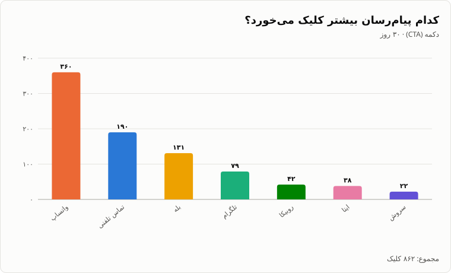
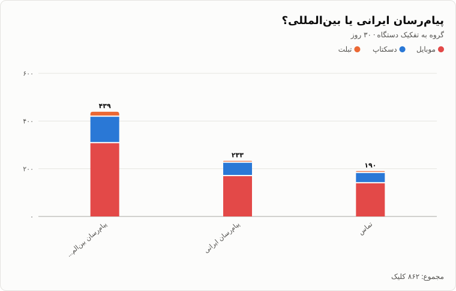
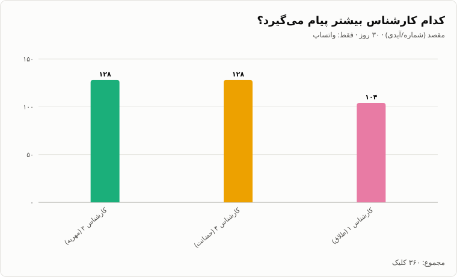
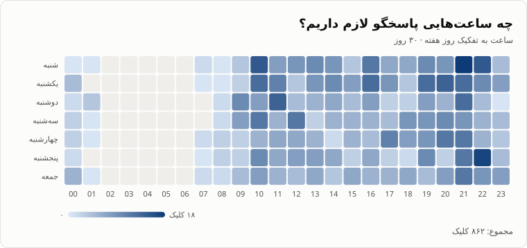
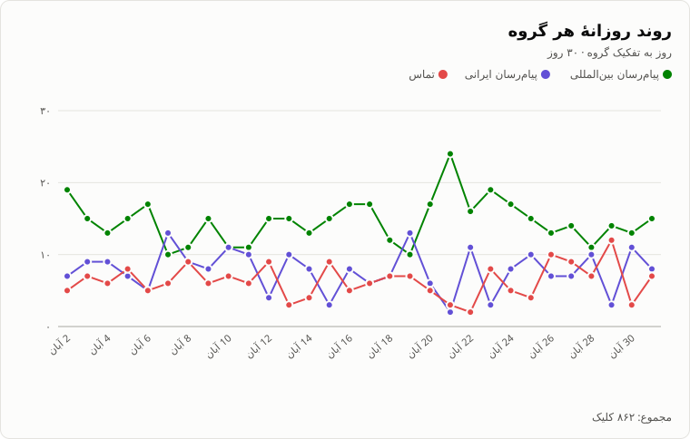
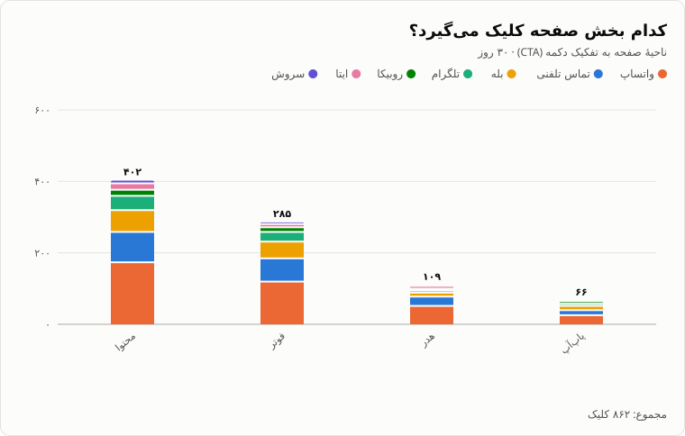

# CTA Tracking

**WordPress plugin that counts clicks on call and messenger buttons (or anything you define by CSS selector) and shows them as bar, line and heat-map charts in the admin. No cookies, no IP addresses, cache-friendly, no chart library. The guide below is in Persian.**

<div dir="rtl">

افزونهٔ وردپرس برای شمارش کلیک دکمه‌های تماس و پیام‌رسان، یا هر عنصری که با سلکتور CSS تعریف کنی. نتیجه را در پیشخوان با نمودار میله‌ای، خطی و حرارتی نشان می‌دهد.
- بدون کوکی و بدون ذخیرهٔ IP
- سازگار با کش صفحه (WP Rocket و مشابه)
- بدون هیچ کتابخانهٔ نمودار



## فهرست

- [نصب](#نصب)
- [سه مفهوم: دکمه، ناحیه، گروه](#سه-مفهوم-دکمه-ناحیه-گروه)
- [ساخت دکمه (CTA)](#ساخت-دکمه-cta)
- [الگوهای آماده برای پیام‌رسان‌ها](#الگوهای-آماده-برای-پیام‌رسان‌ها)
- [نمونه: گروه پیام‌رسان ایرانی و بین‌المللی](#نمونه-گروه-پیام‌رسان-ایرانی-و-بین‌المللی)
- [ساخت ناحیه](#ساخت-ناحیه)
- [ساختن نمودار](#ساختن-نمودار)
- [سناریوها](#سناریوها)
- [عیب‌یابی](#عیب‌یابی)
- [محدودیت‌ها و حریم خصوصی](#محدودیت‌ها-و-حریم-خصوصی)

## نصب

1. فایل `cta-tracking-x.y.z.zip` را از بخش [Releases](https://github.com/ishadmehri/cta-tracking/releases) بگیر. دکمهٔ «Code ← Download ZIP» را نزن؛ آن فایل، کد توسعه است، نه بستهٔ نصب.
2. در وردپرس به «افزونه‌ها ← افزودن ← بارگذاری افزونه» برو، zip را بده و افزونه را فعال کن.
3. کش افزونهٔ کش را یک بار پاک کن. اگر WP Rocket باشد، بعد از هر ذخیرهٔ تنظیمات خودکار پاک می‌شود.
4. صفحه‌ای از سایت را با `?cta_debug=1` در انتهای آدرس باز کن. هر دکمه‌ای که شمرده می‌شود خط‌چین قرمز می‌گیرد، و اگر نشانگر را رویش نگه داری، می‌گوید کدام دکمه است، کدام ناحیه و کدام مقصد.
5. در پنجرهٔ ناشناس روی یک دکمه کلیک کن و آن را در «آمار CTA ← کلیک‌های اخیر» ببین. کلیک خودت به‌عنوان مدیر هم آنجا با علامت «مدیر واردشده» دیده می‌شود، ولی در نمودارها حساب نمی‌شود.

بعد از فعال‌سازی، این‌ها بدون هیچ تنظیمی شمرده می‌شوند:
- **دکمه‌ها:** تماس تلفنی، واتساپ، تلگرام، بله، ایتا، روبیکا و سروش
- **ناحیه‌ها:** پاپ‌آپ، هدر، فوتر، سایدبار و محتوا (برای سایت‌های المنتوری و قالب‌های معمول)

حداقل نسخه‌ها: وردپرس ۶٫۴ و PHP 7.4.

## سه مفهوم: دکمه، ناحیه، گروه

| مفهوم | جواب کدام سؤال | از کجا می‌آید |
|---|---|---|
| **دکمه (CTA)** | چه چیزی کلیک شد؟ (واتساپ، تماس…) | سلکتور CSS خود دکمه |
| **ناحیه** | کجای صفحه بود؟ (هدر، فوتر…) | نزدیک‌ترین والدِ دکمه که با سلکتور یک ناحیه می‌خواند |
| **گروه** | در گزارش جزو کدام دسته است؟ | یک برچسب متنی که روی هر دکمه می‌گذاری |
| **مقصد** | کدام شماره یا کدام آیدی؟ | از خود لینک، با «الگوی مقصد» |

یک دکمهٔ واتساپ ممکن است هم در هدر باشد هم در فوتر. برای همین ناحیه را روی دکمه تعریف نمی‌کنی؛ در لحظهٔ کلیک از روی جای آن در صفحه پیدا می‌شود.

## ساخت دکمه (CTA)

در «آمار CTA ← تنظیمات ← دکمه‌ها» هر ردیف یک دکمه است. «+ دکمهٔ جدید» یک ردیف اضافه می‌کند و «حذف» آن را برمی‌دارد. کلیک‌های گذشتهٔ ردیفِ حذف‌شده پاک نمی‌شوند و در گزارش با کلیدشان می‌آیند.

| فیلد | چه بنویسم | مقدار مجاز |
|---|---|---|
| **کلید** | یک نام کوتاه انگلیسی و ثابت، مثل `whatsapp` | حروف کوچک انگلیسی، رقم، `_` و `-`؛ حداکثر ۴۰ حرف. حروف بزرگ کوچک می‌شوند و فاصله و بقیهٔ نویسه‌ها حذف می‌شوند. باید یکتا باشد. **بعد از شروع ثبت عوضش نکن**؛ کلیک‌ها با کلید ذخیره می‌شوند |
| **نام** | نامی که در نمودار دیده می‌شود، مثل «واتساپ» | هر متنی تا ۸۰ حرف. عوض کردنش گزارش‌های گذشته را هم عوض می‌کند |
| **سلکتور CSS** | کدام عنصرها این دکمه حساب شوند | هر سلکتور معتبر CSS تا ۵۰۰ حرف. ویرگول یعنی «یا». هنگام ذخیره در مرورگر بررسی می‌شود و سلکتور نامعتبر پذیرفته نمی‌شود |
| **اولویت** | فقط وقتی مهم است که دو دکمه روی **همان یک عنصر** بخوانند؛ عدد بزرگ‌تر برنده است | عدد صحیح؛ پیش‌فرض ۱۰ |
| **گروه** | دسته‌ای برای گزارش، مثل «پیام‌رسان ایرانی» | هر متنی تا ۸۰ حرف. متن کاملاً یکسان یعنی گروه یکسان. خالی یعنی «بدون گروه». هر دکمه فقط یک گروه دارد |
| **الگوی مقصد** | یک regex جاوااسکریپت که روی `href` لینک اجرا می‌شود. **گروه اولِ پرانتزدار** ذخیره می‌شود، مثلاً شماره | تا ۲۰۰ حرف. از مقدار ذخیره‌شده فقط حروف و رقم انگلیسی و `_ + . @ -` می‌ماند، حداکثر ۶۴ حرف؛ پس چیز فارسی را با الگو نگیر. خالی یعنی مقصد ثبت نمی‌شود |
| **نام مقصدها** | برای هر مقصد یک اسم، هر خط به شکل `مقدار=نام` | مقدار باید دقیقاً همانی باشد که ذخیره می‌شود. مثال: `989120000001=کارشناس ۱ (طلاق)` |

**قاعدهٔ شمارش:** از عنصری که کلیک شد به سمت بالا می‌رویم و اولین عنصری که با سلکتور یکی از دکمه‌ها بخواند برنده است. یک کلیک حداکثر یک دکمه حساب می‌شود، پس کلیک روی آیکون داخل یک دکمه یا روی متن یک کارت، همان دکمه را می‌شمارد. دابل‌کلیک یک کلیک است.

### سلکتورهای پرکاربرد

| می‌خواهم بشمارم | سلکتور |
|---|---|
| همهٔ لینک‌های تماس | `a[href^="tel:"]` (یعنی href با `tel:` شروع شود) |
| لینک‌هایی که آدرسشان چیزی دارد | `a[href*="wa.me/"]` (یعنی href شامل `wa.me/` باشد) |
| دانلود فایل PDF (مثلاً کاتالوگ) | `a[href$=".pdf"]` (یعنی href با `.pdf` تمام شود) |
| یک دکمهٔ المنتور خاص | در المنتور، «پیشرفته ← کلاس‌های CSS» را مثلاً `cta-consult` بگذار، بعد سلکتور: `.cta-consult a` |
| یک بخش با شناسه | در المنتور، «پیشرفته ← شناسهٔ CSS» را `hero` بگذار، بعد سلکتور: `#hero a` |
| دکمهٔ ارسال فرم | `form button[type="submit"], form input[type="submit"]` (کلیک را می‌شمارد، نه ارسال موفق را) |
| عنصری که خودت نشانه‌گذاری کرده‌ای | `[data-cta="consult"]` |

برای پیدا کردن سلکتور یک عنصر، روی آن راست‌کلیک کن و «Inspect» را بزن؛ کلاس‌ها و `href` آنجا دیده می‌شوند. همیشه نتیجه را با `?cta_debug=1` چک کن.

## الگوهای آماده برای پیام‌رسان‌ها

هفت ردیف اول جدول به‌طور پیش‌فرض ساخته می‌شوند. بقیه را اگر لازم داشتی اضافه کن.

| پیام‌رسان | گروه پیشنهادی | سلکتور | الگوی مقصد | مقصدی که ذخیره می‌شود |
|---|---|---|---|---|
| تماس تلفنی | تماس | `a[href^="tel:"]` | `tel:\+?(\d+)` | شماره |
| واتساپ | پیام‌رسان بین‌المللی | `a[href*="wa.me/"], a[href*="whatsapp.com/send"]` | `(?:wa\.me\/\|phone=)\+?(\d+)` | شماره |
| تلگرام | پیام‌رسان بین‌المللی | `a[href*="t.me/"], a[href*="telegram.me/"]` | `t(?:elegram)?\.me\/(\w+)` | آیدی |
| بله | پیام‌رسان ایرانی | `a[href*="ble.ir/"]` | `ble\.ir\/(\w+)` | آیدی |
| ایتا | پیام‌رسان ایرانی | `a[href*="eitaa.com/"]` | `eitaa\.com\/(\w+)` | آیدی |
| روبیکا | پیام‌رسان ایرانی | `a[href*="rubika.ir/"]` | `rubika\.ir\/(\w+)` | آیدی |
| سروش پلاس | پیام‌رسان ایرانی | `a[href*="splus.ir/"]` | `splus\.ir\/(\w+)` | آیدی |
| آی‌گپ | پیام‌رسان ایرانی | `a[href*="igap.net/"]` | `igap\.net\/(\w+)` | آیدی |
| اینستاگرام (دایرکت) | پیام‌رسان بین‌المللی | `a[href*="ig.me/m/"]` | `ig\.me\/m\/([\w.]+)` | آیدی |
| اینستاگرام (صفحه) | شبکهٔ اجتماعی | `a[href*="instagram.com/"]` | `instagram\.com\/([\w.]+)` | آیدی |
| مسنجر فیسبوک | پیام‌رسان بین‌المللی | `a[href*="m.me/"]` | `m\.me\/([\w.]+)` | آیدی |
| وایبر | پیام‌رسان بین‌المللی | `a[href^="viber:"]` | `number=(?:%2B\|\+)?(\d+)` | شماره |
| پیامک | تماس | `a[href^="sms:"]` | `sms:\+?(\d+)` | شماره |
| ایمیل | تماس | `a[href^="mailto:"]` | `mailto:([^?]+)` | آدرس ایمیل |

## نمونه: گروه پیام‌رسان ایرانی و بین‌المللی

**راه پیشنهادی: هر پیام‌رسان یک دکمه، با گروه مشترک.**

| کلید | نام | گروه |
|---|---|---|
| `whatsapp` | واتساپ | `پیام‌رسان بین‌المللی` |
| `telegram` | تلگرام | `پیام‌رسان بین‌المللی` |
| `bale` | بله | `پیام‌رسان ایرانی` |
| `eitaa` | ایتا | `پیام‌رسان ایرانی` |
| `rubika` | روبیکا | `پیام‌رسان ایرانی` |
| `soroush` | سروش | `پیام‌رسان ایرانی` |
| `tel` | تماس تلفنی | `تماس` |

- **متن گروه باید دقیقاً یکی باشد.** «پیام‌رسان ایرانی» با «پیامرسان ایرانی» (بدون نیم‌فاصله) دو گروه جدا حساب می‌شوند.
- با این کار در نمودارها هم «هر پیام‌رسان» را داری (محور «دکمه») و هم «ایرانی یا بین‌المللی» را (محور «گروه»).
- چون گروه هنگام گزارش اعمال می‌شود، اگر بعداً گروه یک دکمه را عوض کنی، کلیک‌های گذشته‌اش هم به گروه جدید می‌روند.

**راه دوم: یک دکمه برای همه.** اگر فقط مجموع را می‌خواهی، یک دکمه با کلید `iran-messengers` بساز:
- سلکتور: `a[href*="ble.ir/"], a[href*="eitaa.com/"], a[href*="rubika.ir/"], a[href*="splus.ir/"]`
- الگوی مقصد: `(ble\.ir|eitaa\.com|rubika\.ir|splus\.ir)\/`

در این حالت «مقصد» نام دامنه است و باز هم می‌شود پیام‌رسان‌ها را جدا دید. ولی ترکیب «هر پیام‌رسان به تفکیک آیدی» دیگر ممکن نیست. اگر هر دو راه را با هم بسازی، چون هر دو روی همان لینک می‌خوانند، فقط دکمه‌ای که **اولویت** بیشتری دارد شمرده می‌شود.

## ساخت ناحیه

در «تنظیمات ← ناحیه‌ها» هر ردیف یک ناحیه است: **کلید** و **نام** با همان قواعد دکمه‌ها، به‌علاوهٔ یک **سلکتور CSS**.

- ناحیهٔ هر کلیک، **نزدیک‌ترین والدِ** دکمه است که با سلکتور یکی از ناحیه‌ها بخواند. پس ناحیه‌های کوچک‌تر و دقیق‌تر خودبه‌خود بر ناحیه‌های بزرگ برنده می‌شوند. مثلاً دکمه‌ای در بخش «hero» داخل «محتوا»، ناحیهٔ hero می‌گیرد.
- اگر یک عنصر با دو ناحیه بخواند، **ردیف بالاتر** برنده است.
- کلیکی که در هیچ ناحیه‌ای نیست «بدون ناحیه» ثبت می‌شود.

| ناحیه | سلکتور نمونه |
|---|---|
| هدر المنتور | `[data-elementor-type="header"]` |
| فوتر المنتور | `[data-elementor-type="footer"]` |
| پاپ‌آپ المنتور | `[data-elementor-type="popup"]` |
| بخش بالای صفحه | در المنتور «پیشرفته ← شناسهٔ CSS» را `hero` بگذار، بعد سلکتور: `#hero` |
| دکمهٔ شناور | کلاس دکمهٔ شناور، مثلاً `.floating-cta` |
| نوار چسبان موبایل | کلاس آن نوار، مثلاً `.sticky-bar` |
| کارت کارشناس‌ها | `.expert-card` |
| قالب‌های غیرالمنتوری | `.site-header`، `.site-footer`، `aside`، `main` |

## ساختن نمودار

در «آمار CTA ← نمودارها» دکمهٔ «+ نمودار جدید» را بزن. نوع هر نمودار را بعداً هم می‌توانی با دکمه‌های بالای کارتش عوض کنی.

| گزینه | معنی |
|---|---|
| **نوع نمودار** | میله‌ای (مقایسه)، خطی (روند در زمان)، یا حرارتی (جدول شدت؛ پیش‌فرضش ساعت × روز هفته است) |
| **محور افقی** | کلیک‌ها بر اساس چه چیزی دسته شوند: دکمه، گروه، مقصد، ناحیه، دستگاه، سیستم‌عامل، مرورگر، روز هفته، ساعت، روز، صفحه |
| **تفکیک سری‌ها** | بُعد دوم. هر میله را رنگی می‌کند، در خطی خط‌های جدا می‌سازد و در حرارتی ردیف‌ها را. حداکثر ۸ رنگ و بقیه در «سایر»، به‌جز روز هفته، ساعت و روز که همیشه کامل و به ترتیب می‌آیند |
| **بازهٔ زمانی** | امروز، ۷، ۳۰ یا ۹۰ روز، ۶ ماه، یک سال؛ همیشه تا امروز |
| **فقط این دکمه‌ها / ناحیه‌ها / دستگاه‌ها** | فیلترها. خالی یعنی همه. چند فیلتر با هم اعمال می‌شوند |

- هفته از شنبه شروع می‌شود.
- اگر افزونهٔ تاریخ شمسی (مثل wp-parsidate) فعال باشد، تاریخ‌ها شمسی نشان داده می‌شوند.
- هر نمودار یک «جدول داده» برای عدد دقیق دارد، و با نگه داشتن نشانگر روی هر میله یا خانه عددش را می‌بینی.

## سناریوها

عددهای این تصویرها نمونه‌اند.

### ۱. کدام پیام‌رسان را نگه داریم؟
**تنظیم:** میله‌ای · محور: دکمه · بدون تفکیک · ۳۰ روز


پیام‌رسانی که ماه‌ها کلیک نمی‌گیرد، فقط جا گرفته است. یا جایش را عوض کن، یا برش دار.

### ۲. مشتری‌ها پیام‌رسان ایرانی را ترجیح می‌دهند یا بین‌المللی؟
**تنظیم:** میله‌ای · محور: گروه · تفکیک: دستگاه · ۳۰ روز. اول گروه‌ها را مثل [نمونهٔ بالا](#نمونه-گروه-پیام‌رسان-ایرانی-و-بین‌المللی) بساز.



اگر سهم پیام‌رسان ایرانی بزرگ است، دکمه‌اش را کنار واتساپ بیاور. تفکیک دستگاه هم نشان می‌دهد این ترجیح فقط در موبایل است یا همه‌جا.

### ۳. کدام کارشناس بیشتر پیام می‌گیرد؟
**تنظیم:** میله‌ای · محور: مقصد · فیلتر: فقط واتساپ · ۳۰ روز. در تنظیماتِ دکمهٔ واتساپ، «نام مقصدها» را پر کن:

```
989120000001=کارشناس ۱ (طلاق)
989120000002=کارشناس ۲ (مهریه)
989120000003=کارشناس ۳ (حضانت)
```



برای تقسیم کار بین کارشناس‌ها، یا وقتی شمارهٔ یک کارشناس روی یک صفحهٔ پربازدید است.

### ۴. چه ساعت‌هایی پاسخگو لازم داریم؟
**تنظیم:** حرارتی · محور: ساعت · تفکیک: روز هفته · ۳۰ روز. با انتخاب نوع «حرارتی» این دو خودبه‌خود پر می‌شوند.



خانه‌های تیره یعنی ساعت‌هایی که بیشترین پیام و تماس می‌آید؛ شیفت پاسخگویی را با آن بچین. این را با «فقط تماس تلفنی» هم بساز، چون ساعت‌های تماس با پیام فرق دارد.

### ۵. کمپین یا تغییر طراحی اثر داشت؟
**تنظیم:** خطی · محور: روز · تفکیک: گروه · ۳۰ یا ۹۰ روز



روزِ شروع کمپین یا عوض شدن صفحه را بدان و ببین خط بعد از آن بالا رفته یا نه. یک روزِ تنها را جدی نگیر؛ روند چندروزه مهم است.

### ۶. دکمه کجای صفحه بهتر جواب می‌دهد؟
**تنظیم:** میله‌ای · محور: ناحیه · تفکیک: دکمه · ۳۰ روز



اگر فوتر از محتوا کلیک بیشتری می‌گیرد، یعنی کاربر تا پایین صفحه می‌رود و دکمه‌های وسط صفحه دیده نمی‌شوند یا قانع‌کننده نیستند.

### سناریوهای کوتاه دیگر
- **کدام صفحه‌ها مشتری می‌آورند؟** میله‌ای، محور «صفحه».
- **چقدر از ترافیک اینستاگرام می‌آید؟** میله‌ای، محور «مرورگر»؛ «Instagram» یعنی مرورگر داخل اینستاگرام.
- **موبایل یا دسکتاپ؟** میله‌ای، محور «دستگاه»، تفکیک «دکمه». تماس تلفنی در موبایل معمولاً جلوتر است.
- **کدام روزهای هفته شلوغ‌ترند؟** میله‌ای، محور «روز هفته».

## عیب‌یابی

| مشکل | راه حل |
|---|---|
| هنگام فعال‌سازی: «پرونده افزونه پیدا نشد» | zip را از Releases بگیر. اگر خودت zip ساختی، در ویندوز `python build.py` را اجرا کن، نه Compress-Archive پاورشل؛ آن مسیرها را با بک‌اسلش می‌سازد و سرور لینوکسی افزونه را یک پوشه عمیق‌تر باز می‌کند |
| هیچ کلیکی ثبت نمی‌شود | صفحه را با `?cta_debug=1` باز کن. اگر خط‌چین نیست، سلکتور با دکمه نمی‌خواند. اگر خط‌چین هست، کش صفحه را پاک کن |
| خط‌چین هست ولی باز هم کلیکی نمی‌آید | کلیک‌ها به `wp-admin/admin-ajax.php` فرستاده می‌شوند، نه به REST، پس بستن REST برای مهمان مشکلی نیست. اگر افزونهٔ امنیتی `admin-ajax.php` را هم برای مهمان بسته است، `action=cta_tracking_hit` را در آن مجاز کن. در ابزار توسعه‌دهندهٔ مرورگر (تب Network) باید پاسخ ۲۰۴ ببینی |
| فقط بعضی کلیک‌ها ثبت می‌شوند | ممکن است افزونهٔ کش، جاوااسکریپت را با تأخیر اجرا کند. WP Rocket خودکار مستثنا شده؛ برای بقیه، `cta-tracking` و `ctaTrackingConfig` را در فهرست استثنای «Delay JS» بگذار |
| در «سلامت دکمه‌ها» هشدار ۷ روز بدون کلیک | احتمالاً قالب یا لینک دکمه عوض شده و سلکتور دیگر نمی‌خواند |
| کلیک خودم در نمودار نیست | عمدی است: کلیک مدیر واردشده فقط در «کلیک‌های اخیر» دیده می‌شود |

## محدودیت‌ها و حریم خصوصی

- عددها **حداقل**‌اند: کلیک کسانی که اسکریپت را مسدود می‌کنند (ad blocker، معمولاً ۱۰ تا ۲۵٪ کاربران دسکتاپ) ثبت نمی‌شود.
- کلیک داخل iframe و shadow DOM بسته شمرده نمی‌شود.
- **علامت‌گذاری، نه حذف:** کلیک ربات‌ها، مرورگرهای خودکار و کلیکی که با اسکریپت زده شده علامت می‌خورد و در نمودارها حساب نمی‌شود، ولی در «کلیک‌های اخیر» دیده می‌شود.
- **چه ذخیره می‌شود:** فقط زمان، دکمه، ناحیه، مقصد، نوع دستگاه، سیستم‌عامل، مرورگر، عرض صفحه و شناسهٔ صفحه.
- **چه ذخیره نمی‌شود:** IP، کوکی، و هیچ شناسه‌ای برای بازدیدکننده.
- **نگه‌داری:** داده تا ۴۰۰ روز نگه داشته می‌شود؛ قابل تغییر در تنظیمات.
- **رضایت (consent):** اسکریپت را می‌شود خاموش کرد، با فیلتر PHP `cta_tracking_enabled` یا با `window.ctaTrackingConsent = false` در جاوااسکریپت.
- **حذف افزونه:** داده‌ها پاک نمی‌شوند، مگر تیک «پاک شدن هنگام حذف» را در تنظیمات زده باشی.

## توسعه

```
php tests/run.php
node --test tests/tracker.test.mjs
python build.py
```

- طرح اولیه در `docs/design.md` است و تصمیم‌ها در `docs/decisions.md`.
- مجوز: GPL-2.0-or-later.

</div>
